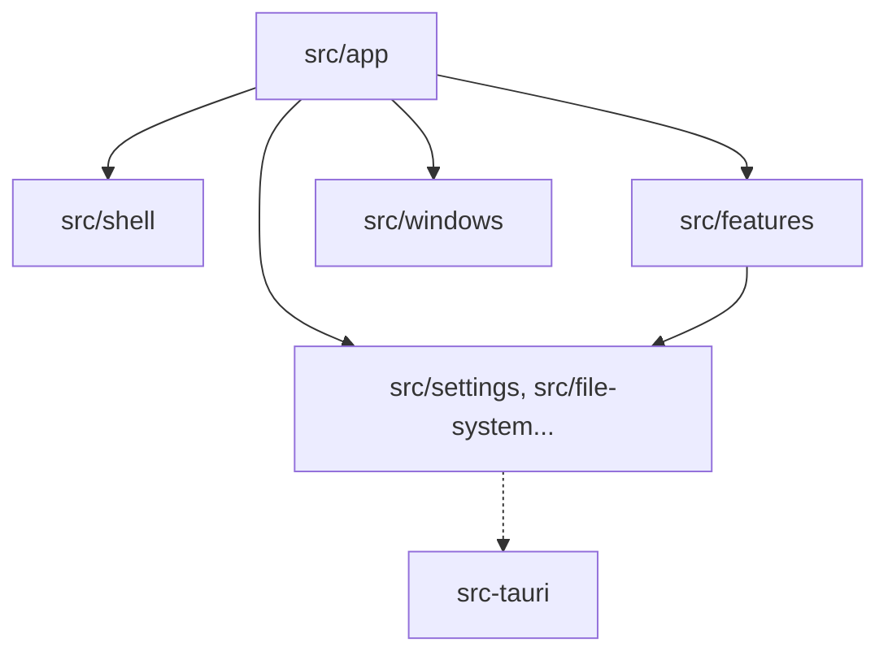

# Radium Panel Lab

Reusable React, TypeScript, and Tauri foundation for premium Windows desktop applications.

  


## Features

- Borderless custom title bar with native window controls.
- Collapsible navigation and project-owned design tokens.
- Internal window manager with move, resize, minimize, maximize, and z-order behavior.
- Optional external Tauri feature windows.
- Generic file, settings, notification, dialog, tooltip, and feedback service boundaries.
- Typed service contracts for future Java, Python, Rust, C#, or local HTTP/WebSocket services.

## Architecture



The application is built on React, TypeScript, Vite, and Tauri. Components use typed service interfaces only, isolating them from Tauri commands. Backend adapters implement these interfaces, enabling easy replacement with other languages or transports. See the [Foundation Guide](docs/foundation-guide.md) and [Backend Boundary](docs/architecture/backend-boundary.md) for more details.

## Quick start

Requires Node.js 20.19 or newer and npm.

Install dependencies:

```bash
npm install
```

Start the frontend preview:

```bash
npm run dev
```

Run the tests:

```bash
npm test
```

Build the frontend:

```bash
npm run build
```

## Configuration

Settings are stored and loaded by the `SettingsService` and available via `useSettings()`.

| Key | Purpose | Default |
| --- | --- | --- |
| `version` | Settings version for migrations. | `1` |
| `colorProfile` | Application accent color family and shade. | `{ family: 'sky', shade: 400 }` |
| `navigationCollapsed` | State of the side navigation bar. | `false` |
| `recentFiles` | List of recently opened file paths. | `[]` |
| `windowBehavior.restoreOnLaunch` | Whether to restore windows when opening the app. | `true` |
| `windowBehavior.rememberBounds` | Whether to remember the bounds of the app window. | `true` |
| `extensionSettings` | Unstructured data for extensions. | `{}` |

## Screenshots


## Roadmap

- Turn Radium Panel Lab into a full visual editor.
- Show the real running app in iframes on a pan-and-zoom canvas.
- Introduce a bridge script to report elements, source location, and styles, and apply preview-only changes.
- Record structured change records (what, where in the source, before, after) instead of rewriting HTML into code.
- Compile records into a production list in Markdown and JSON.
- Implement an MCP server for agents to read the production list.

## License & credits

Released under the [MIT License](./LICENSE). Based on Ember Studio Foundation.
